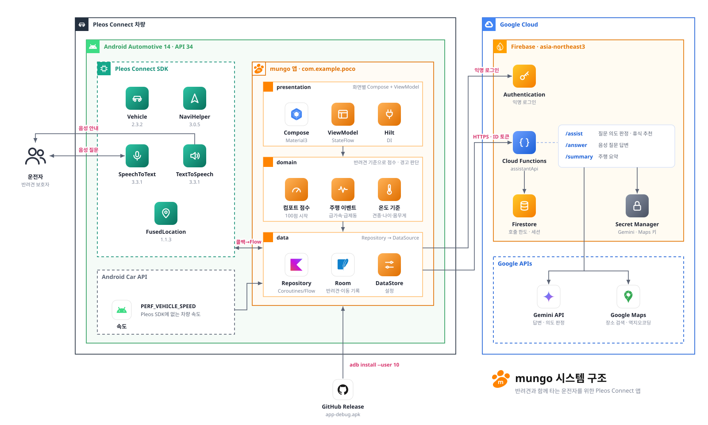

<div align="center">


# mungo

**반려견과 함께 타는 차 안을, 차량 데이터와 음성으로 대신 살펴 주는 Pleos Connect 앱**

2026 현대자동차그룹 차량용 앱 개발 공모전 출품작

[APK 받기](#-apk) · [실행 방법](#-실행-방법) · [테스트 환경](#-테스트-환경-및-필요한-설정) · [구조도](#-구조도)

</div>

---

## 🐶 mungo 소개

강아지는 차가 흔들리거나 안이 더워져도 말을 못 합니다.
mungo는 운전하는 동안 차량 데이터를 읽어 **반려견이 얼마나 편하게 타고 있는지 점수로 보여 주고**, 창문이나 실내 온도처럼 바로 챙겨야 할 일은 **음성으로 알려 줍니다.**

| 기능 | 하는 일 |
|---|---|
| 🎯 **컴포트 점수** | 100점에서 시작해, 급가속·급제동·급커브가 있을 때마다 깎입니다 |
| 🪟 **창문 · 온도 알림** | 반려견 쪽 창문이 열리거나 실내가 위험할 만큼 더우면 화면과 음성으로 알립니다 |
| ☕ **휴식 · AI 비서** | 쉴 때가 되면 반려견과 들를 만한 곳을 추천하고, 운전 중 궁금한 걸 말로 물어볼 수 있습니다 |
| 📒 **이동 기록** | 주행마다 점수 변화와 있었던 일을 남기고, 도착 후 멀미 증상을 기록합니다 |

<br>

## ✨ 핵심 기능

### 1. 반려견 프로필
- 처음 실행하면 이름, 견종, 나이, 몸무게, 차에서 보이는 모습(멀미, 불안, 더위 등)을 입력합니다.
- **견종 · 몸무게 · 나이로 반려견에게 맞는 실내 온도 기준**을 자동으로 정합니다. 단두종, 노령견, 퍼피처럼 더위에 약한 경우 기준이 더 엄격해집니다.
- 여러 마리를 등록할 수 있고, 마이펫에서 고치거나 지울 수 있습니다.

### 2. 홈과 탑승 준비 (P단에서만)
- 홈에서 차량 연결 상태, **실내 온도**, 반려견 쪽 창문, **공기 청정** 상태를 한눈에 봅니다.
  - 실내 온도는 에어컨 설정 온도가 아니라 **차가 잰 실제 실내 온도**입니다. 반려견 기준을 벗어나면 칸이 강조됩니다.
  - **공기 청정** 칸을 누르면 차의 공기 청정이 실제로 켜지고 꺼집니다.
- 탑승 준비에서는 함께 탈 반려견과 앉을 자리를 고르고 안전 체크리스트를 확인합니다.
  - 카시트·하네스는 직접 체크합니다.
  - **반려견 쪽 창문**은 차에서 닫혀 있는 걸 확인하면 자동으로 체크됩니다.

### 3. 주행 중 컴포트 점수
주행을 시작하면 100점에서 출발합니다. 아래 상황이 감지되면 **점수가 깎이고 주행 기록에 남습니다.** (음성 안내 없이 화면 점수와 기록에만 반영)

| 상황 | 감점 | 감지에 쓰는 데이터 |
|---|---|---|
| 급제동 | −5 (강하면 −6) | 속도, 브레이크 페달 |
| 급가속 | −3 | 속도 |
| 급커브 | −4 | 조향각, 진행 방향 |
| 1분 안에 커브 3번 이상 | −5 | 진행 방향 |
| 과속방지턱을 빠르게 통과 | 30km/h 넘으면 −1, 40km/h 넘으면 −2 | 내비 과속방지턱 위치, 속도 |

- 휴식(P단 정차) 중이거나 휴식 뒤 차분하게 달리면 **3분마다 1점씩 회복**합니다(최대 90점).

### 4. 창문 · 실내 온도 알림
| 상황 | mungo가 하는 일 |
|---|---|
| 반려견 쪽 창문이 20% 넘게 열림 | 화면 카드 + 음성 "창문을 닫아 주세요", 버튼 한 번으로 창문 닫기 |
| 실내 온도가 반려견 기준을 벗어남 | 화면 카드에 "실내 온도를 낮춰 주세요"(추우면 "높여 주세요") 표시, 이동 기록에 남김 |
| 위험 온도 도달 (일반 28°C · 단두종·노령견·퍼피 27°C) | 팝업 + 음성 "에어컨을 켜 주세요" |
| 기준보다 더운 상태가 3분 넘게 이어짐 | 화면 카드 + 음성 "더워한 지 3분이 넘었어요. 잠깐 쉬어 갈까요?" (더위가 이어지는 동안 한 번) |

### 5. 휴식 추천과 음성 질문 (AI)
- 휴식 간격(기본 2시간, 30분~3시간)을 정해 두면, **휴식 20분 전에 반려견과 함께 쉴 만한 휴게소·카페·공원을 추천**합니다. 운전자가 고르면 내비 경유지로 추가됩니다.
- **음성으로 질문** 버튼을 누르고 말하면, 지금 차 상태(점수, 온도, 창문, 휴식까지 남은 시간)를 바탕으로 짧게 답하고 읽어 줍니다.
- AI는 별도 로그인이나 연결 코드 없이 바로 쓸 수 있습니다(Firebase 익명 인증). 장소는 Google Maps 결과만 사용합니다.

### 6. 이동 기록
- 주행이 끝나면 점수, 감점 순간, 온도 변화, 흔들림 그래프를 요약해서 보여 줍니다.
- 도착 후 하품·침 흘림 같은 멀미 징후를 체크하면, 일주일 단위로 모아 보고 다음 휴식 간격을 제안합니다.

<br>

## 🗺 구조도



- **차량 안:** 앱이 Pleos Connect SDK와 Android Car API로 차량 상태를 읽고, 창문 닫기·내비 경유지·음성을 다룹니다.
- **클라우드:** AI 기능(음성 질문, 휴식 장소 추천, 주행 요약)만 Firebase Cloud Functions를 거쳐 Gemini와 Google Maps를 부릅니다. Gemini·Maps 키는 서버에만 있고 APK에는 들어가지 않습니다.

### 사용하는 Pleos SDK

| SDK | 버전 | 용도 |
|---|---|---|
| Vehicle | 2.3.2 | 기어, 창문, 실내 온도, 공기 청정 켜기·끄기, 브레이크, 조향 |
| NaviHelper | 3.0.5 | 과속방지턱 위치, 경로 시작·도착, 경유지 추가 |
| TextToSpeech | 3.3.1 | 음성 안내, AI 답변 읽기 |
| SpeechToText | 3.3.1 | 음성 질문 듣기 |
| FusedLocation | 1.1.3 | 진행 방향, 휴식 장소 검색 위치 |

속도는 Android Car API(`PERF_VEHICLE_SPEED`)로 읽습니다.
SDK 문서: [Connect SDK](https://document.pleos.ai/docs/pleos-only/connect-sdk-pleos/) · [API Reference](https://document.pleos.ai/api-reference/connect-sdk-pleos)

### 기술 스택

| 분야 | 사용 기술 |
|---|---|
| 앱 | Kotlin, Jetpack Compose(Material3), Hilt, Coroutines/Flow |
| 저장 | Room, DataStore |
| 차량 | Pleos Connect SDK, Android Car API |
| 서버 · AI | Firebase Cloud Functions, Firebase Auth(익명), Firestore, Gemini API, Google Maps |
| 품질 | ktlint, JUnit |

minSdk 28 · targetSdk 37 · JDK 17 · 화면은 가로로 고정

### 코드 구조

```
app/src/main/java/com/example/poco
├── core          테마, 공용 컴포넌트, 점수 계산 엔진, 유틸
├── data          Room, Pleos SDK, Car API, AI 서버 연동, repository
├── domain        견종별 기준, 흔들림 분석
└── presentation  화면별 Compose + ViewModel
functions/        Firebase Cloud Functions (Gemini · Google Maps 호출)
```

화면은 ViewModel만 알고, ViewModel은 repository를 통해 데이터를 가져옵니다.
Pleos SDK는 콜백 방식이라 `data/pleos/datasource`에서 suspend 함수나 Flow로 바꿔 두었고, SDK 초기화는 `PleosSdkManager`가 처음 쓸 때 한 번 합니다.

<br>

## 📦 APK

| 받는 곳 | 위치 |
|---|---|
| GitHub Release | https://github.com/Team-POCO-2026/POCO/releases |
| 직접 빌드한 경우 | `app/build/outputs/apk/debug/app-debug.apk` |

Release에 올린 APK에는 AI 서버 연결 정보가 들어 있어, 설치만 하면 AI 기능까지 바로 쓸 수 있습니다.

<br>

## 🚀 실행 방법

### 방법 A. APK로 바로 설치 (권장)

1. [Release](https://github.com/Team-POCO-2026/POCO/releases)에서 `app-debug.apk`를 받습니다.
2. Pleos Connect 에뮬레이터를 켠 뒤, 운전자 계정(user 10)에 설치합니다.

   ```bash
   adb install -r --user 10 app-debug.apk
   ```

3. 화면 아래 독의 **mungo(발바닥) 아이콘**을 눌러 엽니다.
   `am start`로 열면 차량 화면에 보이지 않는 경우가 있어 아이콘을 직접 누르는 게 확실합니다.

### 방법 B. 소스에서 빌드

Android Studio로 열고 `app` 구성을 실행하거나, 터미널에서 빌드합니다. Pleos SDK는 `settings.gradle.kts`에 적어 둔 Pleos Maven 저장소(`nexus-playground.pleos.ai`)에서 받아 옵니다.
기본 JDK가 17보다 낮으면 Android Studio에 들어 있는 JDK를 지정하세요.

```bash
# macOS
JAVA_HOME="/Applications/Android Studio.app/Contents/jbr/Contents/Home" ./gradlew assembleDebug

# Windows
JAVA_HOME="C:\Program Files\Android\Android Studio\jbr" ./gradlew assembleDebug

adb install -r --user 10 app/build/outputs/apk/debug/app-debug.apk
```

AI 기능까지 쓰려면 빌드 전에 `local.properties`에 Firebase Web API 키를 넣어야 합니다. 이 키는 저장소에 공개하지 않고 **따로 공유**합니다([필요한 설정](#필요한-설정) 참고). 키 없이 AI까지 확인하려면 Release APK를 쓰세요.

### 처음 실행하면

**인트로 → 반려견 프로필 입력 → 홈(차량 정보·창문·위치·음성 권한 요청)** 순서로 진행됩니다.
탑승 준비는 기어가 P일 때만 열리고, 주행을 시작하면 점수가 매겨집니다.

<br>

## 🧪 테스트 환경 및 필요한 설정

### 개발에 쓴 에뮬레이터

| 항목 | 값 |
|---|---|
| 에뮬레이터 | **Pleos Connect v2.1.0** (`Pleos_Connect_v2.1.0`) |
| 시스템 이미지 | `android-34/pleos_car_emulator/arm64-v8a` (Android 14, API 34, Automotive) |
| 화면 해상도 | **2560 × 1440 px, 160 dpi (mdpi), 가로** |
| 디자인 기준 | 앱 영역 1700 × 1184 dp. 화면 분할로 앱 창이 1600 dp보다 좁아지면 화면 전체를 같은 비율로 줄여 그림 |
| 개발 환경 | macOS (Apple Silicon), Android Studio, JDK 17 |

### 필요한 설정

| 항목 | 방법 |
|---|---|
| 기어 · 창문 · 온도 · 브레이크 · 조향 바꾸기 | `adb forward tcp:8088 tcp:8088` 후 http://127.0.0.1:8088 (Pleos Virtual Console) |
| 속도 바꾸기 | Virtual Console에 속도 조작이 없어서 adb로 넣습니다. 아래 예시 참고 |
| 더위 알림 확인 | 실내 온도를 adb로 덮어쓸 수 있습니다(디버그 APK만). 아래 예시 참고 |
| 휴식 추천(AI) 바로 보기 | 2시간을 기다리지 않고 주행 중에 adb로 바로 띄웁니다(디버그 APK만). 아래 예시 참고 |
| 공기 청정 | 설정 없음. 홈의 공기 청정 칸을 누르면 차량 공조가 켜지고 꺼집니다 |
| 마이크 | 에뮬레이터 Extended Controls → Microphone → *Virtual microphone uses host audio input* 켜기 |
| AI 기능 (직접 빌드할 때만) | `local.properties`에 `POCO_FIREBASE_API_KEY=키` 추가. **키는 README에 공개할 수 없어 팀에 따로 요청해 받습니다.** 서버 주소(`POCO_ASSISTANT_URL`)는 `gradle.properties`에 이미 있음. 자세한 건 [functions/README.md](functions/README.md) |

```bash
# 속도 60km/h (값은 m/s: 60 / 3.6 = 16.7)
adb shell cmd car_service inject-vhal-event 0x11600207 16.7

# 실내 온도를 29°C로 덮어쓰기 (더위 알림·위험 온도 확인용) / 음수를 보내면 해제
adb shell am broadcast --user 10 -p com.example.poco -a com.example.poco.DEBUG_TEMP --ef celsius 29
adb shell am broadcast --user 10 -p com.example.poco -a com.example.poco.DEBUG_TEMP --ef celsius -1

# 휴식 20분 전 장소 추천(AI)을 지금 바로 띄우기 (주행 중일 때만)
adb shell am broadcast --user 10 -p com.example.poco -a com.example.poco.DEBUG_REST

# 처음 설치한 상태로 되돌리기 (프로필 · 기록 · 권한 · 설정 삭제)
adb shell pm clear --user 10 com.example.poco

# 앱 완전히 종료 (데이터 유지)
adb shell am force-stop --user 10 com.example.poco
```

Windows에서는 같은 일을 하는 PowerShell 스크립트를 쓸 수 있습니다.

| 스크립트 | 하는 일 |
|---|---|
| `.\tools\vehicle-sim.ps1 drive` | D → 출발 → 급제동 → 급가속 → 정지 → P 짧은 주행 시나리오 (`speed 60`, `hardbrake`, `accel` 등 개별 명령도 있음) |
| `.\tools\reset-first-run.ps1` | 처음 설치한 상태로 되돌리기 |
| `.\tools\stop-app.ps1` | 앱 완전히 종료 |

> [!NOTE]
> - 직접 빌드할 때 Firebase 키를 넣지 않으면, AI 연결 시 운영자가 발급하는 연결 코드를 요구합니다. AI를 뺀 나머지 기능은 그대로 됩니다. Release APK에는 키가 이미 들어 있어 따로 받을 필요가 없습니다. Gemini·Maps 키는 서버에만 있습니다.
> - 에뮬레이터에서는 Pleos 온디바이스 음성 엔진이 `ON_DEVICE_ENGINE_ERROR`로 뜨지 않을 수 있습니다. 이 경우 **음성 질문과 음성 안내**만 동작하지 않고, 화면 알림·휴식 장소 추천·주행 요약 같은 AI 기능은 그대로 확인할 수 있습니다. 음성과 내비 연동(경유지 추가 등)은 실제 차량에서 확인해야 합니다.
> - Release APK는 디버그 빌드라 위의 `DEBUG_TEMP`, `DEBUG_REST` 명령을 그대로 쓸 수 있습니다.

> [!WARNING]
> `adb root`는 차량 화면이 깨지니 쓰지 마세요.

### 테스트

```bash
./gradlew testDebugUnitTest          # 앱 단위 테스트
./gradlew connectedDebugAndroidTest  # 에뮬레이터 연결 테스트 (SDK 스모크 테스트 포함)

npm ci --prefix functions            # 서버 의존성 설치 (Node 22.12 이상)
npm test --prefix functions          # 서버 테스트
```

<br>

## 🤝 같이 작업할 때

- 브랜치는 `feat/#이슈번호-작업명`, 커밋은 `feat/#이슈번호: 설명` 형식으로 씁니다.
- 커밋 전에 `./gradlew ktlintFormat`을 돌려 주세요.
- main에는 직접 올리지 않고, PR 리뷰를 받은 뒤 합칩니다.
- 패키지 이름(`com.example.poco`)은 기존 앱 식별자를 유지합니다. 클래스·함수·테마 이름과 앱 표기는 Mungo/mungo로 통일했습니다.

디자인: [Figma](https://www.figma.com/design/g7UnrDclVk077ot6Hyi64i/)
